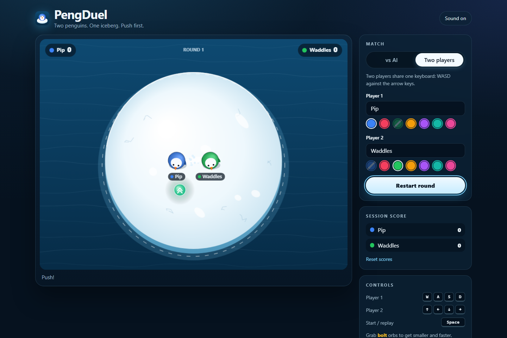
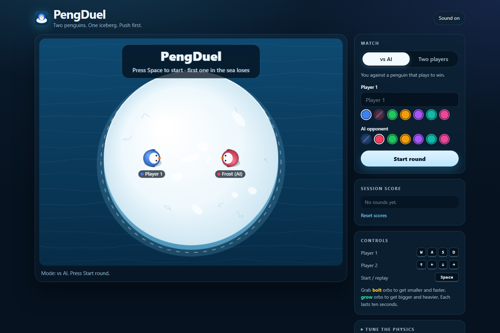

# PengDuel

**Two penguins. One iceberg. Push first.**

PengDuel is a small browser physics game by Noah Hicks. Two penguins share a floating iceberg,
and the first one pushed into the sea loses the round. Play against an AI that plays to win, or
against a friend on the same keyboard.

**Play it now: <https://redlynx101.github.io/PengDuel/>**



## Features

- **Single player against Frost, the AI.** It works its way between you and the middle of the
  iceberg, then charges outward; it backs away from the edge when it is in danger and grabs a
  power-up when one is clearly closer to it.
- **Local two-player mode.** WASD against the arrow keys, with names and colours for each side.
- **Collision-based pushing.** Momentum, mass and approach speed decide who goes flying.
- **Power-ups.** Bolt orbs make a penguin smaller and faster; grow orbs make it bigger and
  heavier. Each lasts ten seconds, with a ring that counts down around the penguin.
- **Readable at a glance.** A 3-2-1 countdown, an in-arena scoreboard, a red warning glow on the
  rim when a penguin is close to the edge, splash and impact effects, and a crown for the last
  round's winner.
- **Tunable physics.** Sliders for iceberg size, penguin size, push force and ice grip.
- **Plays the same everywhere.** Physics runs at a fixed 60 steps per second regardless of the
  screen's refresh rate; on phones, hold and drag on the ice to steer Player 1.
- **Accessible controls.** Keyboard-operable setup, live status announcements, reduced-motion
  support (no screen shake, fewer particles) and a remembered mute toggle.



## Controls

| Action | Keys |
| --- | --- |
| Player 1 | `W` `A` `S` `D` (also the arrow keys against the AI) |
| Player 2 | Arrow keys |
| Start or replay a round | `Space` or `Enter`, or click the arena |
| Touch | Hold and drag on the ice to steer Player 1 |

## Run locally

The game is a static page, so any static file server works:

```powershell
python -m http.server 8000
```

Then open <http://localhost:8000>. The Flask entry point used by Replit and Gunicorn serves the
same page:

```powershell
python -m pip install "flask==3.1.3"
python main.py   # http://127.0.0.1:5000
```

## Tests

```powershell
python -m unittest discover -s tests -v
```

The tests check that the Flask route serves the game surface, that every local asset reference
is relative (so the page works from the `/PengDuel/` subpath on GitHub Pages) and exists, and
that static assets are served. Gameplay itself is exercised in a real browser.

## Deployment

Every push to `main` runs the tests and deploys `index.html` and `static/` to GitHub Pages
(`.github/workflows/deploy-pages.yml`). The older Replit deployment
(<https://peng-duel-noahhicks101.replit.app/>) runs the same files through Flask when it is
redeployed; the GitHub Pages build is the one that always matches this repository.

## Project structure

```text
index.html            page markup
static/css/styles.css page styles
static/js/game.js     game loop, rounds, input and page UI
static/js/Penguin.js  penguin physics and drawing
static/js/AIPenguin.js
static/js/PowerUp.js
static/js/effects.js  particles, ripples, labels, screen shake
static/js/render.js   water, iceberg, HUD and overlays
static/js/audio.js    Web Audio wrapper with mute
static/js/config.js   shared settings and defaults
static/assets/        sound effects and music
main.py, wsgi.py      Flask entry point for Replit / Gunicorn
```

## Authorship and assets

The repository is maintained under Noah Hicks's GitHub account; its history includes Replit
Agent-assisted iterations, and the October 2026 visual refresh was made with AI assistance.
Every visual (penguins, iceberg, water, power-ups, crown, favicon) is now drawn in code in this
repository. The bundled sound effects and music predate that refresh, and their original
provenance is not documented well enough to grant downstream reuse rights; treat them as
demonstration assets.

## Public access and reuse

The source is publicly viewable. The repository does not currently contain a license file, so it
should not be described as open-source licensed, and public visibility should not be read as
broad reuse permission.
